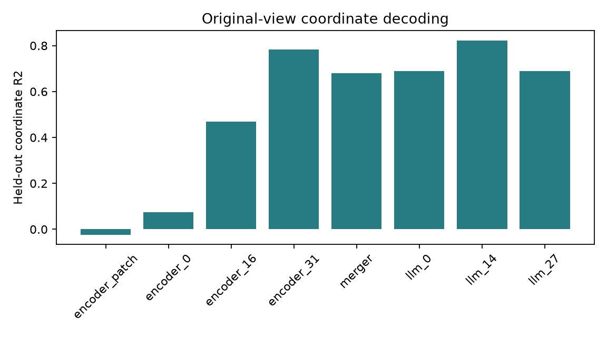
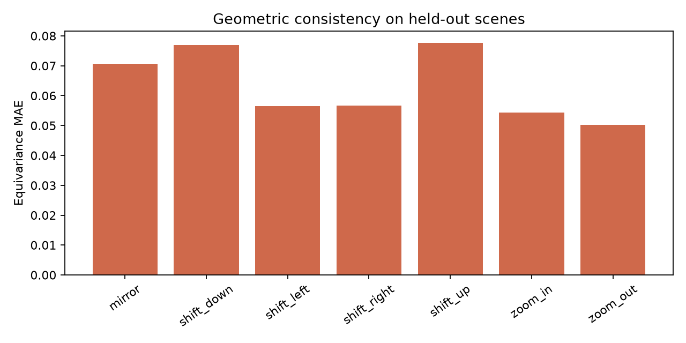
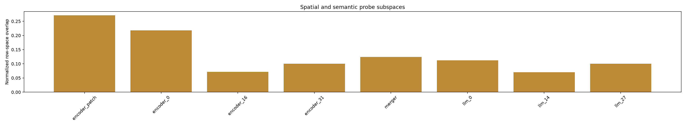
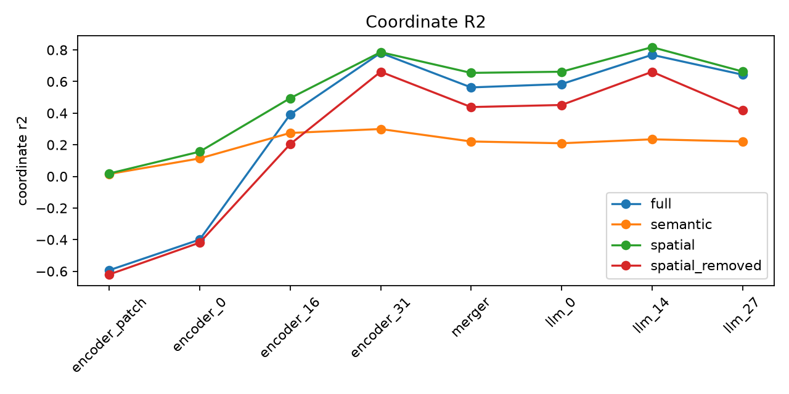
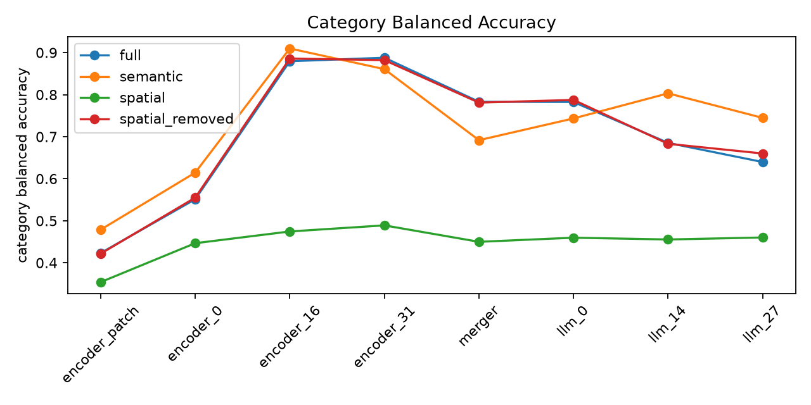

# StreetSpatial V0 实验报告

日期：2026-11-11  
状态：已完成 200 个场景的探索性实验。共 10 个场景经过逐张目检，另外 190 个场景仍采用未经逐张审核的目标检测候选框。

## 摘要

本实验使用真实 Google Street View 街景和冻结的 Qwen2.5-VL-7B-Instruct，完成了图像变换、对象级特征提取、坐标探针以及视觉编码器、视觉合并层和多模态语言模型之间的比较。几何标签与视觉 Token 对齐通过自动检查。

按场景划分独立测试集后，模型后期特征可以线性解码物体在图像中的归一化中心坐标。原始视图上，LLM 第 14 层表现最好：三个探针随机种子的平均坐标 R² 为 **0.823**，平均绝对误差（MAE）为 **0.054**。视觉编码器第 31 层的 R² 为 **0.784**，MAE 为 **0.060**。

目前的证据支持“Qwen 表征中存在可解码的空间信息”，**尚不支持模型具有独立、专用的内部空间坐标系**。关键原因是：直接利用标注框所覆盖的 Patch 位置计算坐标时，MAE 仅为约 **0.007**，R² 约为 **0.995**。该对照使用了已有标注框，是几何信息的参照上限，并非只凭图像就能运行的模型基线。它说明物体所在的 Patch 位置几乎已经决定了预测目标；探针的良好表现不能单独证明模型形成了脱离物体位置的坐标编码。

## 数据、模型与质量检查

- **数据来源：**现有 `real20k_20261110/images.train.jsonl` 清单中的真实街景图像；未修改原始图片。
- **场景与划分：**最终纳入 200 个不同全景场景，其中 Austin 66、Bogota 45、London 58、Lagos 31。按 `scene_id` 划分训练、验证、测试集，场景数分别为 120、40、40；同一场景的所有变换视图只进入同一个集合。
- **标注状态：**10 个场景经过逐张目检；其余 190 个场景采用 Grounding DINO 候选框。无法确认用途的未审核灯杆候选统一记为宽泛类别 `Pole`，不当作已确认的 `Lamp Post`。
- **视图与对象：**共得到 1,398 个有效视图、3,175 条对象视图记录。视图包括原始、水平镜像、平移与缩放。若变换无法完整保留标注对象，则跳过该视图。主分析各阶段的训练、验证、测试对象视图数分别为 1,905、629、641。
- **几何检查：**标注框、中心点、镜像和平移后的关系标签、裁剪边界及场景分组均通过检查；12 项单元测试通过。
- **模型与运行环境：**Qwen2.5-VL-7B-Instruct 和 Grounding DINO tiny 的模型文件保存在 NAS，下载文件经 SHA256 核验。特征提取使用 Transformers 4.56.2、BF16 前向计算，并将对象特征以 FP16 缓存。
- **Token 对齐：**每个视图均有 154 个图像 Token；Merger 与 LLM 图像嵌入的最大对齐误差为 0。八个缓存阶段均覆盖 1,398 个视图，数值有限。

完整审计记录见 [pilot200_audit.json](manifests/pilot200_audit.json)。

### 街景与变换示例

实验使用同一真实街景生成原始、水平镜像、平移和缩放视图；镜像后对象的左右次序应相应反转。原始街景、变换图像与标注框审核拼图不随公开仓库发布。200 个场景中只有前 10 个经过逐张目检，其余检测候选框不能视为人工确认的真值。

## 分析方法

提取的阶段为 `encoder_patch`、`encoder_0`、`encoder_16`、`encoder_31`、`merger`、`llm_0`、`llm_14` 和 `llm_27`。利用核验过的视觉 Token 空间映射，在对象框内做掩码均值池化，形成每个对象的特征。

每个阶段独立训练坐标探针：先在训练集上标准化并降至 128 个 PCA 分量，再用岭回归预测归一化中心坐标 `(x, y)`。PCA 和探针只使用训练场景的原始视图；验证集选择正则化参数；独立测试集包含原始视图及有效的变换视图。随机种子 17、42、73 分别对训练场景重采样。下表报告三个种子的均值；对应标准差及适用指标的按场景 Bootstrap 95% 置信区间保存在结果 CSV 中。

例如，LLM 第 14 层在 93 个原始视图测试对象上，种子 42 的 MAE 为 0.053，按场景 Bootstrap 的 95% 置信区间为 [0.046, 0.060]；R² 为 0.830，区间为 [0.779, 0.857]。

完整指标见 [metrics](metrics)，图表见 [figures](figures)。

## RQ1：坐标能否解码，变换后是否保持几何一致性？

### 原始视图的坐标探针

| 特征阶段 | 坐标 R² | MAE |
|---|---:|---:|
| 视觉编码器 Patch 嵌入 | -0.024 | 0.148 |
| 视觉编码器第 0 层 | 0.073 | 0.140 |
| 视觉编码器第 16 层 | 0.470 | 0.112 |
| 视觉编码器第 31 层 | 0.784 | 0.060 |
| 视觉合并层 Merger | 0.680 | 0.073 |
| LLM 第 0 层 | 0.689 | 0.072 |
| LLM 第 14 层 | **0.823** | **0.054** |
| LLM 第 27 层 | 0.689 | 0.078 |

图 1：独立测试集原始视图的坐标解码 R²，越高越好。该图也用于 RQ3 的阶段比较；原始输出中的 `fig_rq3_coordinate_transfer.png` 与本图内容相同。



预测平均坐标的基线 MAE 为 0.146，随机特征探针约为 0.149。视觉编码器后期及 LLM 第 14 层明显优于这两个基线；Patch 嵌入和最早期层没有表现出同等水平的可解码性。

直接根据对象标注框覆盖的 Patch 位置估计中心坐标，MAE 为 0.0068、R² 为 0.995。由于这个对照直接使用当前标注框，它只能作为“已知对象区域时位置有多容易恢复”的几何参照。现有探针结果证明位置可从特征中读出，不能证明读出过程独立于已知对象区域的空间位置。

### 几何等变性与对象关系

在训练集原始视图上训练探针后，固定探针参数，在测试集变换视图上比较预测结果与预期几何变换。LLM 第 14 层的等变性 MAE：水平镜像 0.052、向左平移 0.037、向右平移 0.042、放大 0.043、缩小 0.039；向上和向下平移分别为 0.058 和 0.049。视觉编码器第 31 层在镜像上的误差为 0.053，平移误差范围为 0.034–0.064。

图 2：各变换在已测试阶段上的平均等变性 MAE，越低越好。图中不是单独的 LLM 第 14 层结果；该层的数值以上文及指标 CSV 为准。



对 LLM 第 14 层的镜像测试视图，由绝对坐标预测之差恢复对象关系，左右顺序准确率为 0.939、上下顺序准确率为 0.833，关系坐标的 MAE 为 0.065。结果显示解码出的坐标对几何变换具有一定一致性；但单凭这些结果，仍无法区分模型学到的独立坐标表示与对物体 Patch 位置的稳定读取。

### 跨类别迁移

在 `Car`、`Tree` 上训练坐标探针，转而在未见过的 `Pole`、`Traffic Sign` 上测试，LLM 第 14 层三个种子的平均 R² 为 0.485、MAE 为 0.070；标准原始视图测试集的 R² 为 0.823。跨类别测试仅有 24 个对象，早期阶段的 R² 为负。该结果提示存在部分迁移，但还不足以证明坐标解码对物体类别不敏感。

## RQ2：空间与语义信息如何组织？

空间探针和类别探针的行空间只有部分重叠。子空间重叠均值在 LLM 第 14 层为 0.070（标准差 0.042），视觉编码器第 31 层为 0.101，Merger 为 0.124，Patch 嵌入为 0.271。后期阶段重叠较低，提示两类任务信息在所测线性子空间内更容易区分；**较低重叠不等于统计独立，也不等于因果独立**。

图 3：各阶段空间与语义探针行空间的重叠度。数值较低仅说明所测线性子空间重叠较少。



在 LLM 第 14 层，仅保留空间探针投影后，坐标 R² 为 0.817，类别平衡准确率为 0.455；仅保留语义探针投影后，坐标 R² 为 0.234，类别平衡准确率为 0.803。移除已学到的空间探针行空间后，坐标 R² 仍为 0.661，类别平衡准确率为 0.683。空间探针识别的二维子空间因此没有涵盖全部坐标信息；空间与语义信息既可部分区分，也可能分布式地交织于其余维度中。

图 4：完整特征、空间投影、语义投影和移除空间探针行空间后的坐标解码。绿色空间投影曲线较高，红色曲线在后期阶段仍高于零。



## RQ3：坐标信息在模型各阶段如何变化？

原始视图的坐标 R² 从 Patch 嵌入的 -0.024 逐步提升至视觉编码器第 31 层的 0.784；进入 Merger 后为 0.680，LLM 第 0 层为 0.689，LLM 第 14 层达到最高的 0.823，至第 27 层降为 0.689。MAE 及镜像、平移一致性也体现相近的阶段变化。Merger 后仍保留可解码的空间信息；已测试阶段中，LLM 第 14 层最容易读出坐标。

空间与语义的线性子空间关系也随阶段改变。视觉编码器第 31 层和 LLM 第 14 层同时表现为较低的子空间重叠和较好的坐标解码，而早期编码器阶段的坐标解码较弱、重叠较大。这里比较的是各阶段在共同任务上的表现，没有直接比较不同维度特征的原始子空间角度。

图 5：相同四类特征投影下的类别平衡准确率。空间投影仍可解码一部分类别，但明显弱于语义投影。



## 大物体敏感性分析

只保留原始视图中标注框较短边至少为 20 像素的对象，并要求每个场景至少保留两个对象后，剩余 129 个场景、1,948 条对象视图记录。趋势仍在：视觉编码器第 31 层 R² 为 0.766（MAE 0.066），Merger 为 0.625（MAE 0.081），LLM 第 14 层为 0.775（MAE 0.060）。具体数值会随对象尺寸分布变化，但后期阶段的优势保留。结果见 [sensitivity](sensitivity)。

## 结论与后续工作

1. **RQ1：**后期特征可以线性解码物体坐标，解码结果对镜像、平移和缩放具有一定几何一致性。强劲的 Patch 位置参照阻止我们将其解释为独立坐标系。
2. **RQ2：**空间与语义信息在所测线性子空间中可部分区分，但空间探针行空间移除后仍能解码坐标，因此不能认为它们完全分离。
3. **RQ3：**坐标解码从视觉编码器早期到后期增强，经过 Merger 后有所下降，在 LLM 第 14 层达到峰值，至第 27 层回落；大物体筛选后主要趋势保留。

当前最重要的工作是逐张审核另外 190 个场景的标注框和类别，然后在审核后的数据上重新运行固定分析。现阶段的语义、跨类别迁移和对象关系结论都可能受到检测或类别错误影响。原始环境中的审核拼图不包含在公开仓库中。

若要进一步检验“内部空间坐标系”，还需设计保留物体外观而改变或消除绝对 Patch 位置的对照，并加入 DINOv2、CLIP 等独立视觉特征对照。**目前不建议直接开展因果 Patching**。如审核与对照实验后结果仍可复现，视觉编码器第 31 层及 LLM 第 14 层是优先候选；干预实验需同时设置等维随机子空间、匹配扰动范数及非空间特征对照。当前 200 场景实验应视为可行性研究，扩展到 500 场景宜安排在标注审核和位置对照之后。

## 复现

在 `/root/code/urban-visual-gene/streetspatial_v0` 目录运行：

```bash
bash scripts/run_v0.sh
```

脚本依次运行单元测试、视图检查、可续跑的冻结特征提取、缓存审计与主分析。模型、数据、特征缓存、指标和图表位于 NAS；原始街景文件仅作读取输入。
