# StreetSpatial V0.1 实验报告

状态：已运行 E1–E4、跨阶段比较及小样本连续变换实验。分析使用真实街景与冻结 Qwen2.5-VL-7B-Instruct 的 V0 缓存；连续变换的 3 张图像重新经过同一模型。所有数值来自 `metrics/` 中的 CSV。本文的科学等级判断为 **Level 1：位置可解码**。现有证据不足以将模型内部表征判定为超越显式位置索引的独立潜在坐标系。

## 1. Executive Summary

E1 最关键：在相同对象框与 Token 掩码下，仅由选中 Token 的网格位置、覆盖范围和 Fourier 统计构成的位置基线，Encoder 31 原图测试 MAE 为 **0.0073**、R² 为 **0.9946**；真实隐藏特征为 **0.0601**、**0.7841**。LLM 14 对应为位置基线 **0.0136**、**0.9822**，真实特征 **0.0541**、**0.8231**。位置基线没有读取模型隐藏状态，但仍使用了已知真实对象框来选择 Token。这足以解释 V0 的主要坐标解码现象，不能量化“模型内部独立位置表征”的比例。

E2 显示真实特征的二维读出对镜像及平移有一定几何规律，但位置基线更一致。额外审计发现，部分 Crop 视图把对象推到画面边缘；原图和变换图都要求对象框至少距边缘 20 像素后，主要差距仍然存在。E3 的跨类别读出可以计算，然而样本仅 24 个未见类别对象，且位置基线显著优于真实特征。E4 的独立训练场景验证发现坐标探针二维方向能保留坐标读出，但移除该方向后仍有较多坐标信息，类别信息也能从该方向读出。整体未达到 Level 3。

## 2. Data and Audit

- 200 个不同街景场景，场景级训练/验证/测试划分为 120/40/40。全部 1,398 个变换视图可访问，特征缓存与清单文件名逐一对应。
- 1,398 个视图中，80 个来自已逐张目检的 10 个场景，1,318 个仍是自动检测候选。测试集仅有 **1 个已审核场景、2 个对象**；其余 39 个测试场景的框与类别仍未逐张人工核验。
- 对象 ID 与类别在原图和变换图之间一致；裁剪窗口和镜像标记可精确复原各视图对象框。每个视图有 154 个图像 Token，缓存的 Merger→LLM 对齐误差为 0。
- 使用 V0 原有的对象框掩码均值池化。位置控制也基于相同 Token 掩码；原始框坐标没有放入“position_only”特征。`oracle_bbox` 是直接读取已知标注框中心的恒等参照，MAE 为 0，绝非模型基线。
- 冻结模型、提示词 `Describe the image.`、原始视图拟合、场景级测试与三个种子 17/42/73 均沿用固定协议。误差区间按场景 Bootstrap 300 次；不能把同一场景多个视图当独立样本。

审计详情见 [audit.json](manifests/audit.json)。原始图像、人工审核拼图、模型权重与完整特征缓存仍在 NAS，不包含在本报告目录中。

**图像来源说明：**当前 NAS 中每个街景点保存的是 `_0/_90/_180/_270` 四张按相机朝向导出的透视图；V0.1 每个场景只选其中一张作为 400×300 或 400×400 像素的源图，再在这张图内裁剪。`scene_id` 去掉朝向后缀只是防止同一街景点跨训练/测试集泄漏，不能表示实验直接使用了完整 360° 全景。以本文 Austin 案例为例，源图是 `_0.jpg`，不是原始全景图。

### 一个已审核测试街景的具体例子

下图是测试集中的 Austin 街景 `Austin_d0g3XZ59cg25iKdi1i8q4w_0`。红框 `tree_1` 是左侧较大的树，蓝框 `tree_2` 是道路中部较小的树；两个对象的框经过逐张目检。每幅图的叉号是对象框的真实中心，空心圆是 Encoder 31 隐藏特征探针的预测，十字符号是仅 Token 位置基线的预测。探针在训练场景拟合，这个街景没有参与拟合；表中使用种子 42。坐标均已除以图像宽高，左上角为 `(0,0)`。

含真实街景画面的八视图案例图由 `python -m src.v01_case_study` 在原实验主机生成，未随公开仓库分发；下表保留对应的真实计算坐标。

| 同一街景中的实例 | 对象 | 真实中心 `(x,y)` | Encoder 31 预测 | 仅 Token 位置预测 | 直观含义 |
|---|---|---:|---:|---:|---|
| 原图 | 左侧大树 | (0.266, 0.408) | (0.337, 0.417) | (0.267, 0.411) | 模型把树判得偏右；位置基线贴近框中心。 |
| 水平镜像 | 同一棵大树 | (0.734, 0.408) | (0.639, 0.414) | (0.732, 0.410) | 树确实到了画面右侧，模型也向右移动，但幅度不够。 |
| 裁剪窗口左移 | 同一棵大树 | (0.366, 0.408) | (0.400, 0.420) | (0.356, 0.411) | 画面里的树向右约 0.10；模型预测也向右。 |
| 裁剪窗口右移 | 同一棵大树 | (0.166, 0.408) | (0.343, 0.410) | (0.178, 0.411) | 树向左约 0.10，但框距边缘仅 3.8 像素；这是受贴边影响的案例。 |
| 裁剪窗口上移 | 道路中部小树 | (0.579, 0.520) | (0.567, 0.419) | (0.571, 0.500) | 树在画面中下移约 0.10，模型的纵坐标几乎没动。 |
| 放大 | 左侧大树 | (0.225, 0.392) | (0.361, 0.404) | (0.232, 0.388) | 放大使树离画面中心更远；框距边缘 16.3 像素。 |

原图里真实位置是大树在小树左边；镜像后顺序反过来。模型这两幅图的左右顺序都读对了，但单个对象的绝对坐标仍有明显误差。这个例子说明“方向大致正确”和“坐标准确”是两种不同要求。右移和放大视图的红框大树不符合下文 20 像素边距的严格分析条件；不能用这两个预测误差单独推断模型的几何能力。该案例也只是一个已审核场景，不能代替总体统计。

## 3. E1 — Position Leakage Control

下表为独立测试集原图、三个种子的均值（MAE 越低越好）。每个阶段有 93 个测试对象，来自 40 个场景。

| 条件 | Encoder 31 MAE / R² | Merger MAE / R² | LLM 14 MAE / R² |
|---|---:|---:|---:|
| 均值坐标先验 | 0.1459 / -0.022 | 0.1459 / -0.022 | 0.1459 / -0.022 |
| 类别条件均值 | 0.1328 / 0.232 | 0.1328 / 0.232 | 0.1328 / 0.232 |
| Oracle Patch 几何 | 0.0068 / 0.995 | 0.0130 / 0.983 | 0.0130 / 0.983 |
| 仅 Token 位置 | **0.0073 / 0.995** | **0.0136 / 0.982** | **0.0136 / 0.982** |
| 固定位置绑定随机 Token | 0.0555 / 0.730 | 0.0254 / 0.913 | 0.0277 / 0.892 |
| 每视图独立随机 Token | 0.1479 / -0.057 | 0.1473 / -0.041 | 0.1476 / -0.047 |
| 真实隐藏特征 | 0.0601 / 0.784 | 0.0730 / 0.680 | 0.0541 / 0.823 |
| 位置预测后的特征残差 | 0.1508 / -0.129 | 0.1597 / -0.300 | 0.1546 / -0.257 |
| 位置加真实特征 | 0.0159 / 0.979 | 0.0253 / 0.949 | 0.0248 / 0.947 |

Encoder 31 仅位置基线的场景 Bootstrap MAE 95% CI 为 **[0.0067, 0.0080]**；真实特征为 **[0.0519, 0.0683]**。在同一对象上按场景配对比较，真实特征比位置基线高 **0.0528 MAE**，差值 95% CI **[0.0446, 0.0610]**；LLM 14 高 **0.0405**，区间 **[0.0339, 0.0480]**。条件组合探针在验证集选岭回归正则化后，测试误差反而增加，因此没有观察到稳健增量。残差仅移除了指定岭回归位置模型能预测的部分，不能视为完全剥离位置。固定位置绑定随机特征也能取得较好结果，说明“池化时保留了哪个 Token”本身就承载大量位置线索。未获取 Qwen 2D-RoPE 的独立绝对位置向量，以上位置统计是可计算的代理基线。

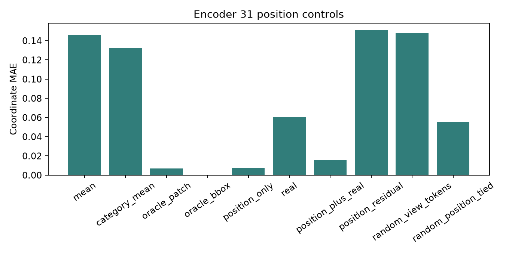

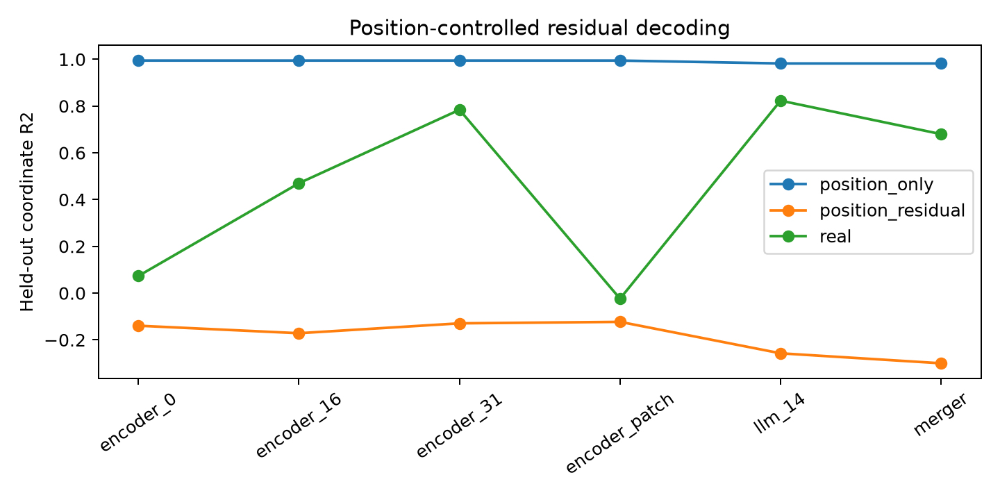

## 4. E2 — Latent Coordinate Trajectory

统一二维坐标读出只在训练场景原始视图上拟合，再固定应用于 40 个未见测试场景的有效变换视图。Encoder 31 的镜像、裁剪窗口左移、裁剪窗口右移等变性 MAE 分别为 **0.0534、0.0343、0.0370**；仅位置基线分别为 **0.0028、0.0054、0.0057**。这里的“左移/右移”指 Crop 窗口移动，画面内容向相反方向移动。真实特征的水平变换方向正确率约 **0.83–0.96**，但缩放方向仅约 **0.44–0.49**。候选二维坐标方向在部分变换上优于随机二维方向，但没有超越位置控制。

有效对象数按变换分别为：镜像 93、左移 62、右移 78、上移 88、下移 80、放大 54、缩小 93。每个对象的真值、二维读出、按实际 Crop 计算的期望位置与误差都在 [e2_latent_trajectories.csv](metrics/e2_latent_trajectories.csv)。轨迹图展示误差较小与较大的单对象案例，叉号是真值，空心圆是读出。

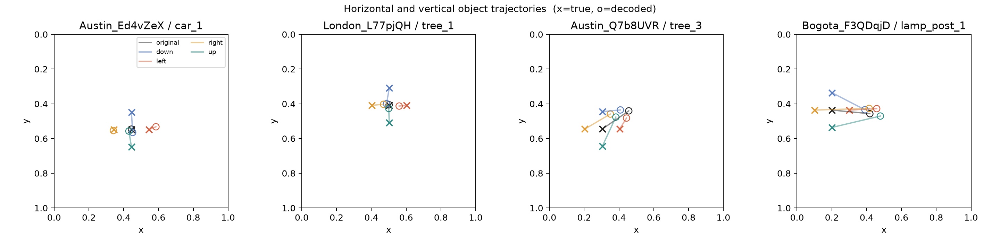

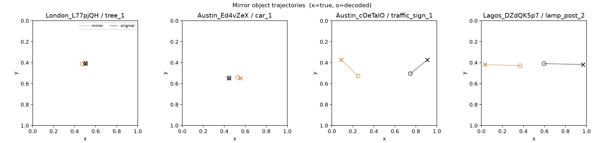

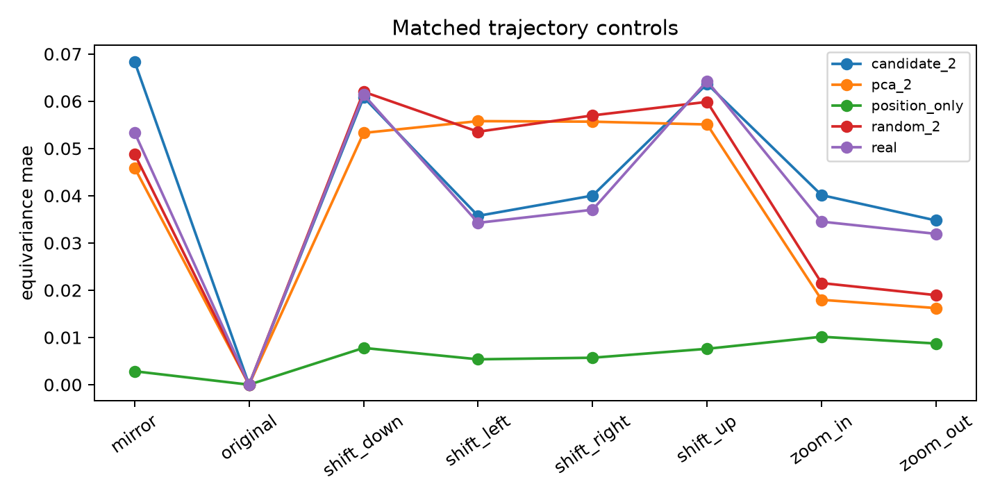

### Crop 设计与贴边敏感性

原始源图若为 400×300 像素，基准裁剪窗口是 320×240 像素，再放大到 400×300。窗口右移 32 像素时，同一物体在输出图上向左移动 40 像素，即归一化横坐标减 0.10。**这个几何映射正确，但不是只改变 Token 位置的干净干预**：窗口同时改变背景和对象周围上下文；对象靠近边界时，标注框内仍可见不等于其全部外观仍可见。镜像也改变局部外观，缩放改变尺度和重采样。

更合适的后续取景流程是从同一张原始 360° 全景生成固定朝向、俯仰角和视场角的宽幅透视图，然后在这张共同的透视画布内生成大小一致、相互错位的模型输入窗口。先确定对象框及其安全边距，再选择全部窗口均完整包含该对象的样本；变换前后使用同一次透视投影，以避免朝向变化带来的透视形变。不能把四张已经投影过的朝向图简单拼成无缝全景，也不能把经纬度全景图上的矩形位移直接当作透视图像中的平移。此方案尚未运行，因为当前数据目录没有对应的原始全景图；下文所有统计仍来自现有单朝向源图。

含真实街景画面的裁剪窗口示意图由 `python -m src.v01_crop_audit` 在原实验主机生成，未随公开仓库分发。

在上述已审核街景里，右移窗口将红框大树推到输出图左边缘，框边距仅 **3.8 像素**；放大后的边距为 **16.3 像素**。这两个视图都应从严格的轨迹案例里排除。全部测试集 641 条对象视图记录中，**90 条**框距边缘不足 20 像素；这些是视图记录，不是 90 个独立对象。其中右移视图为 **11/78**，放大视图为 **12/54**。若同时要求原图与变换图的框均至少距边缘 20 像素，右移可评价对象降为 **59 个、31 个场景**，Encoder 31 真实特征的等变性 MAE 从 **0.0370** 降为 **0.0327**，仅位置基线为 **0.0056**。镜像保留 **75 个、38 个场景**，真实特征 MAE **0.0540**，位置基线 **0.0024**；放大保留 **42 个、24 个场景**，分别为 **0.0324** 与 **0.0107**。这是看到贴边案例后追加的事后敏感性分析，不能当作预注册的主结果。边距筛选缓解部分误差，但不改变位置基线更稳定的结论。边距只是可见性代理，不能保证视觉外观完全不变；大部分对象框仍是自动检测候选。逐对象边距见 [crop_edge_audit.csv](metrics/crop_edge_audit.csv)，阈值 0/10/20/30 的场景聚类区间见 [e2_edge_margin_sensitivity.csv](metrics/e2_edge_margin_sensitivity.csv)。

连续变换使用实际新图像和重新提取的模型特征：2 个测试场景产生 3 张二次变换图像。Encoder 31 的双镜像组合误差平均 **0.0080**（2 场景），右移后上移为 **0.0232**（1 场景）；LLM 14 为 **0.0089** 与 **0.0377**。这是小样本描述性检查，不能推断组合律在总体场景成立。二次 JPEG 编码与重采样也可能贡献误差。

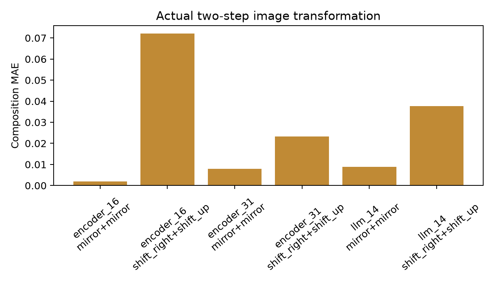

## 5. E3 — Cross-object Transfer

在训练场景的 `Car/Tree` 上拟合，到测试场景的 `Pole/Traffic Sign` 上评价。未见类别仅 **24 个对象**；匹配参照对象来自 **16 个唯一已见类别对象**，重复匹配已在 CSV 记录。测试参照按城市、中心位置、框大小与覆盖面积进行最近邻匹配；可见性没有可靠的独立标注，因此未能控制。四类读出使用完全相同的未见类别对象。

| 条件 | Encoder 31 未见类别 MAE / R² | LLM 14 未见类别 MAE / R² |
|---|---:|---:|
| 仅 Token 位置 | 0.0079 / 0.989 | 0.0145 / 0.953 |
| 真实特征 | 0.0839 / -0.070 | 0.0657 / 0.336 |
| 位置残差 | 0.1909 / -2.460 | 0.1889 / -2.862 |
| 候选二维方向 | 0.0655 / 0.145 | 0.0599 / 0.456 |

Encoder 31 真实特征的未见类别 MAE 95% CI 为 **[0.0622, 0.1071]**，相对匹配已见类别的 Transfer Gap 为 **+0.0170**；LLM 14 为 **[0.0470, 0.0864]**、**+0.0104**。Leave-one-category-out 结果也在 [e3_category_transfer.csv](metrics/e3_category_transfer.csv)；`Traffic Sign` 测试对象只有 4 个，不能据此得出可靠泛化结论。自动候选的类别误差会进一步影响该比较。

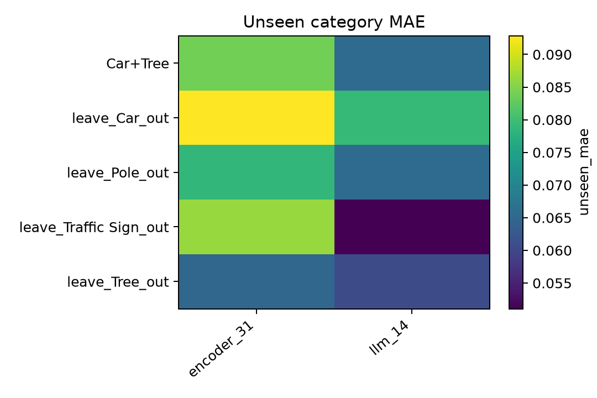

## 6. E4 — Spatial–Semantic Disentanglement

120 个训练场景按种子再分成独立的子空间发现与探针训练场景，各约 60 个；40 个测试场景只用于最终评估。发现组分别得到坐标探针方向、PCA 方向、固定随机方向，以及同一对象镜像、平移、缩放特征差分的 SVD 方向。探针在另一组训练场景重新拟合，因此二维坐标探针自己的训练输出不是独立证据。

Encoder 31 的候选坐标二维投影在测试集上坐标 R² 为 **0.786**、类别平衡准确率 **0.489**；随机二维投影对应 **-0.040、0.298**。但移除这二维方向后坐标 R² 仍有 **0.662**，类别准确率 **0.882**。语义四维方向仍有坐标 R² **0.290**；镜像差分四维方向为 **0.440**。LLM 14 候选二维方向的坐标 R² 为 **0.817**、类别准确率 **0.456**。低线性重叠和局部投影表现不能证明空间与语义统计独立，更不能证明因果独立。

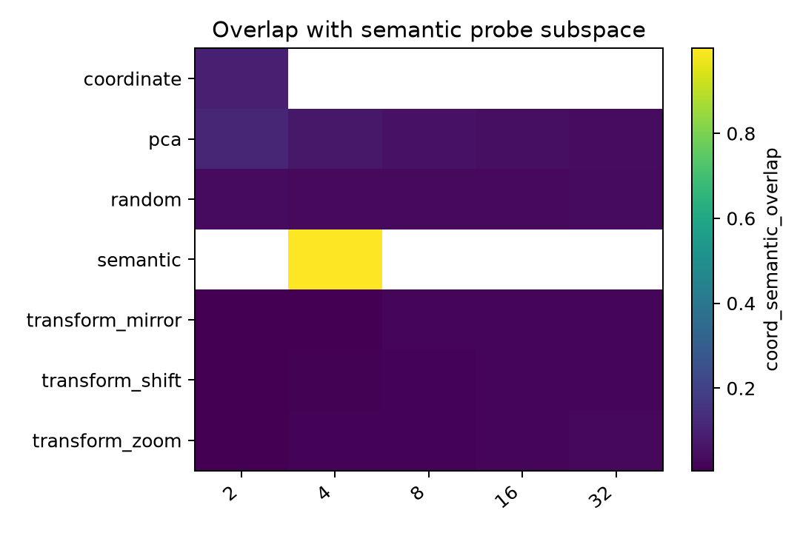

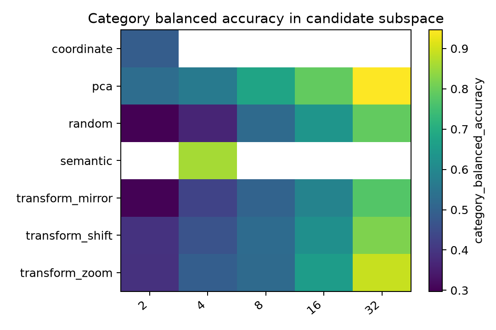

## 7. Cross-stage Analysis

对 Encoder 16、Encoder 31、Merger、LLM 14 使用相同对象、场景划分与探针容量。七种非原图变换按变换类别等权平均，真实特征的等变性 MAE 约为 **0.0526、0.0453、0.0563、0.0457**；对应位置基线为 **0.0069、0.0069、0.0127、0.0127**。深层 Encoder 与 LLM 14 均较容易读出位置，但这不能直接解释为模型“新增”了空间信息。不同阶段的隐藏维度不同，不比较原始子空间角度。

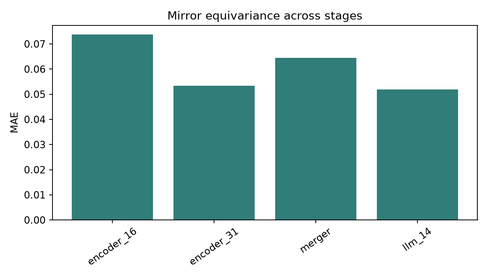

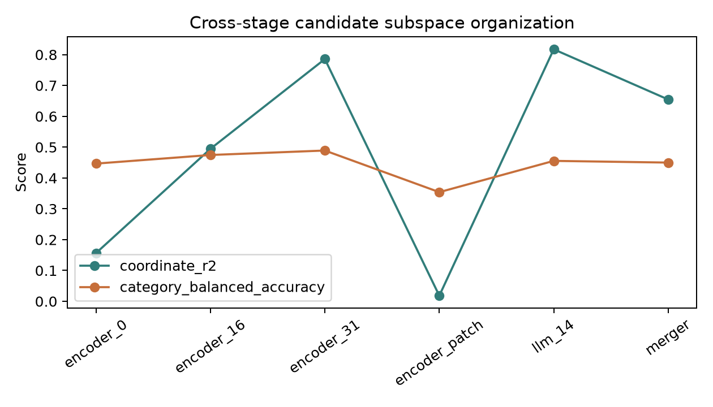

## 8. Scientific Interpretation

**Q1. 已知框与 Patch 位置能解释多少？**仅 Token 位置已达到 Encoder 31 R² 0.995、LLM 14 R² 0.982，并优于真实特征；现有坐标解码证据基本可由对象区域选择和显式位置解释。这里不能把 R² 差值解释为因果贡献比例。

**Q2. 是否有稳定的潜在几何轨迹？**真实特征有部分方向一致性，但镜像、平移、缩放总体不如位置控制。连续变换样本太少，目前不足以确认独立的潜在几何表示。

**Q3. 能否跨类别？**真实特征可在 24 个未见类别对象上读出一些位置，LLM 14 好于 Encoder 31；位置基线仍明显更强，类别与标注质量限制结论。

**Q4. 与语义是否耦合？**候选坐标方向能读出类别，移除该方向后仍能读出坐标。当前线性证据支持分布式混合表示，不能证明独立。

**Q5. 视觉与多模态阶段有何区别？**Encoder 31 与 LLM 14 的真实特征读出较好，Merger 相对较弱；三者都没有超越显式位置控制。结论是操作性读出差异，不是信息产生或消失的证明。

## 9. Limitations

190/200 个场景仍为未经逐张审核的自动检测候选；测试集人工审核仅 1 场景、2 对象，无法提供可靠的审核子集统计。对象框本身用于选择 Token，因此位置控制同样是 Oracle 对象区域条件下的分析，不能当作端到端视觉定位。Crop 只保证标注框未越界；贴边、背景变化与重采样会影响外观，20 像素边距筛选仍无法完全消除这些混杂。残差只控制所指定位置代理与线性 Ridge 映射。`position_plus_real` 在有限样本下出现性能下降，不能据此证明真实特征绝无增量信息。跨类别样本量、类别不均衡及可见性未标注限制 E3。连续变换仅 2 场景，不足以支持总体几何组合律。

## 10. Next-step Recommendation

先取得对应街景的原始 360° 全景，并按上节方案从共同的宽幅透视画布裁切；逐张审核余下 190 个场景，再预注册位置条件下的评估协议。重新生成变换时，应先规定对象距输出图边缘的最小距离、在原图与变换图上共同执行，并记录被排除的对象与场景；随后设计保持对象外观而改变绝对 Token 网格位置、且不依赖测试框坐标的输入对照。新图像必须重新提取冻结模型特征并重新计算探针与基线，不能沿用本报告数值。待审核与位置对照后若仍有稳健增量，再考虑扩大数据和研究因果功能；当前不建议将结果表述为内部专用坐标系。

复现入口：`bash scripts/run_v0_1.sh`。运行环境需能读取配置中的 NAS 街景、V0 特征缓存和本地模型快照；脚本不会更改 V0 结果。
